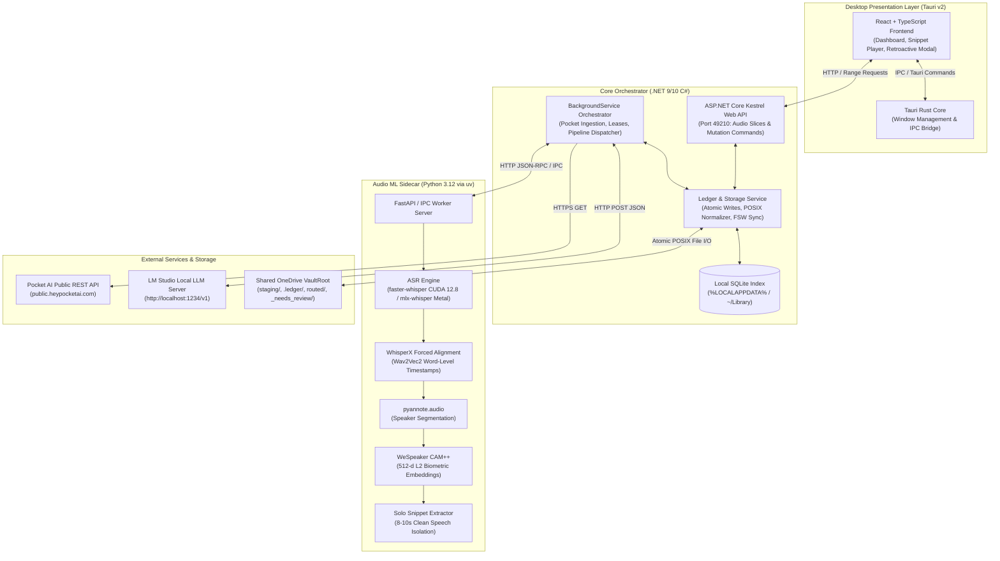
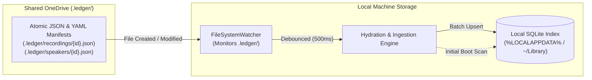
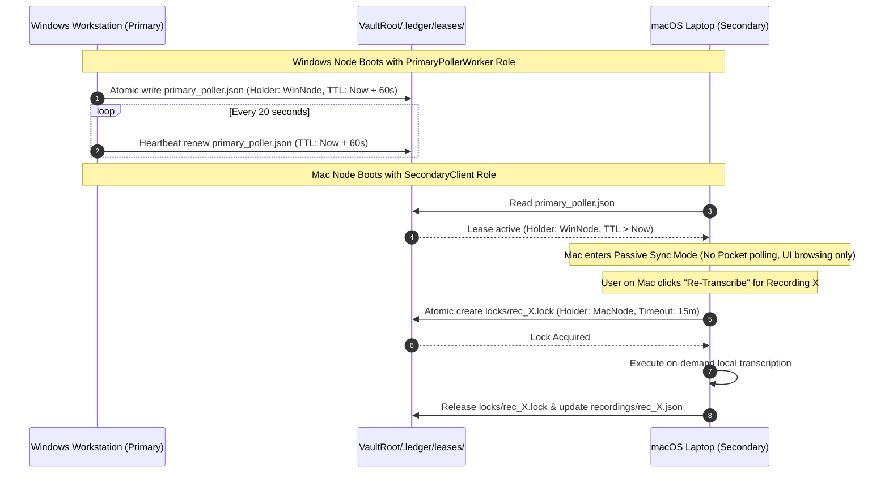
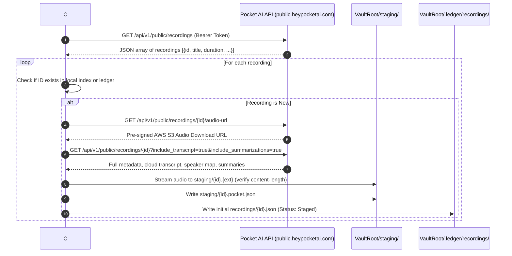
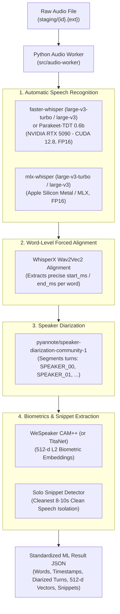
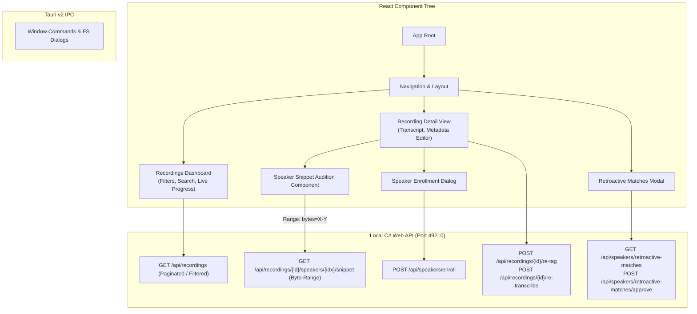
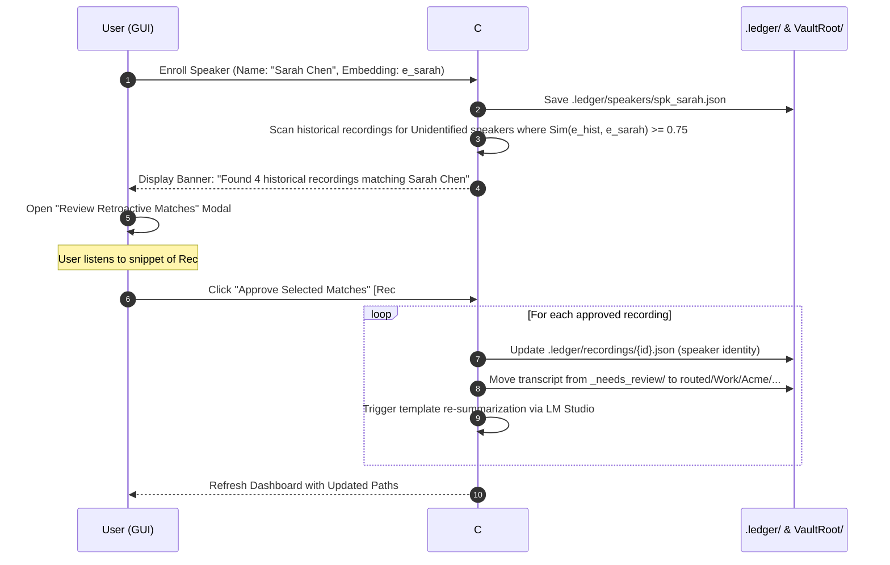

# Technical Design Document

**Phase status:** Approved

## Introduction & Executive Overview

The `pocket-sync` feature establishes a robust, cross-platform pipeline and desktop application that synchronizes voice recordings from Pocket AI (`heypocketai.com`), re-transcribes audio locally with state-of-the-art speech models, segments and biometrically identifies recurring speakers, classifies recordings against a structured taxonomy, and routes formatted transcripts and template-based Markdown summaries into a shared OneDrive vault.

The design adheres to the following foundational engineering principles:
1. **Zero Cloud Lock-In & Total Privacy:** Transcription, diarization, biometric speaker extraction, taxonomy classification, and summarization execute strictly locally (via local GPUs/Metal and local LLMs hosted in LM Studio).
2. **Multi-Machine OneDrive Safety:** Canonical cross-machine state is persisted exclusively as atomic JSON and YAML file manifests in `VaultRoot/.ledger/` using POSIX relative paths. This prevents OneDrive binary database corruption and sync conflicts while allowing each machine to project state into an isolated local SQLite database.
3. **Hardware-Optimized Acceleration on AC Power:** The pipeline leverages the full power of dedicated hardware when connected to AC power—NVIDIA RTX 5090 24GB VRAM (CUDA 12.8+, Blackwell sm_120) on Windows 11 and Apple Silicon unified memory (Metal / MLX) on macOS.
4. **Non-Destructive Workflows & Human-in-the-Loop Safeguards:** Original audio streams in `staging/` remain permanently intact. TagLibSharp modifies only audio container metadata. Retroactive speaker matches across historical recordings are proposed through a dedicated GUI modal and require explicit user approval before files are re-routed.

---

## Traceability to Approved Requirements

This design directly addresses and traces to Requirements 1 through 15:

| Requirement ID | Requirement Title | Primary Design Section |
| :--- | :--- | :--- |
| **REQ-1** | Pocket AI Cloud Recording & Metadata Ingestion | [Ingestion Pipeline & Pocket API Integration](#ingestion-pipeline--pocket-api-integration) |
| **REQ-2** | Multi-Machine Shared OneDrive Vault Storage & POSIX Paths | [Storage Architecture & Vault Organization](#storage-architecture--vault-organization) |
| **REQ-3** | Cross-Machine Atomic State Ledger & Conflict-Free Projection | [Atomic Ledger & Local SQLite Projection](#atomic-ledger--local-sqlite-projection) |
| **REQ-4** | Distributed Sync Coordination & Role-Based Work Leases | [Distributed Coordination & Lease Protocol](#distributed-coordination--lease-protocol) |
| **REQ-5** | Local High-Fidelity Audio Re-Transcription & Word Alignment | [Audio ML Sidecar Pipeline](#audio-ml-sidecar-pipeline) |
| **REQ-6** | Speaker Diarization, Biometrics, & Solo Snippet Extraction | [Diarization, Biometric Embedding, & Solo Snippets](#diarization-biometric-embedding--solo-snippets) |
| **REQ-7** | Biometric Speaker Voicebank Matching, Enrollment, & Disambiguation | [Voicebank Matching & Speaker Enrollment](#voicebank-matching--speaker-enrollment) |
| **REQ-8** | Taxonomy Classification & Metadata Confidence Scoring | [Taxonomy Classification & Decision Runtime](#taxonomy-classification--decision-runtime) |
| **REQ-9** | Audio Container Metadata Tagging & Staging Preservation | [Audio Container Tagging (TagLibSharp)](#audio-container-tagging-taglibsharp) |
| **REQ-10** | Vault Folder Routing & Needs-Review Quarantining | [Vault Folder Routing & Quarantining](#vault-folder-routing--quarantining) |
| **REQ-11** | Local LLM Prescribed Markdown Summarization | [Template-Based LLM Summarization](#template-based-llm-summarization) |
| **REQ-12** | Cross-Platform Desktop GUI Dashboard & Recording Inspection | [Desktop GUI Architecture](#desktop-gui-architecture) |
| **REQ-13** | Desktop GUI Speaker Management, Snippet Playback, & Enrollment | [Speaker Audition & Snippet Streaming](#speaker-audition--snippet-streaming) |
| **REQ-14** | Desktop GUI Retroactive Speaker Matching & Guided Batch Re-Routing | [Retroactive Speaker Match Workflow](#retroactive-speaker-match-workflow) |
| **REQ-15** | Desktop GUI Manual Re-Tagging, Re-Transcription, & Re-Summarization | [Manual Re-Tagging, Re-Transcription, & Re-Summarization](#manual-re-tagging-re-transcription--re-summarization) |

---

## High-Level System Architecture

The system consists of four primary runtime components interacting across clear IPC and network boundaries:



### Component Roles & Responsibilities

1. **Desktop GUI (`src/ui` + `src-tauri`):**
   - Built with Tauri v2, React 18+, TypeScript, Tailwind CSS, and TanStack Query.
   - Provides an asynchronous dashboard, audio snippet playback, speaker enrollment, retroactive match approval modal, and taxonomy re-tagging.
   - Communicates with the local C# backend via standard HTTP REST and HTML5 Media byte-range requests.

2. **Core Backend & Orchestrator (`PocketExport.Api` + `PocketExport.Core`):**
   - Implemented in C# (.NET 9/10) as an ASP.NET Core application with background hosted services (`BackgroundService`).
   - Supervises the Python ML sidecar child process and monitors memory utilization.
   - Executes Pocket REST API polling, manages distributed role leases, performs atomic ledger file writes, synchronizes the machine-local SQLite projection, invokes LM Studio, writes audio container tags using `TagLibSharp`, and handles file routing.

3. **Audio ML Sidecar (`src/audio-worker`):**
   - Hermetic Python 3.12 environment managed using `uv`.
   - Exposes an internal IPC / HTTP server listening exclusively on loopback.
   - Executes GPU-accelerated ASR, forced alignment, diarization, 512-d embedding extraction, and solo audio snippet boundary detection.

4. **Decision & Summarization Runtime (LM Studio):**
   - Local OpenAI-compatible server at `http://localhost:1234/v1`.
   - Serves structured JSON taxonomy classifications using JSON Schema constraints, and generates Markdown summaries using prescribed templates.

---

## Storage Architecture & Vault Organization

### Traced to REQ-2, REQ-3

All shared files reside within a single user-configured OneDrive directory designated as `VaultRoot`. To guarantee cross-platform compatibility between Windows and macOS and eliminate OneDrive sync errors, all intra-vault references are stored strictly as POSIX relative paths.

### Directory Layout

```text
<VaultRoot>/
├── staging/
│   ├── {recording_id}.m4a              <- Original raw audio (preserved permanently)
│   └── {recording_id}.pocket.json      <- Verbatim Pocket AI cloud metadata & cloud transcript
├── .ledger/
│   ├── recordings/
│   │   └── {recording_id}.json         <- Atomic canonical recording manifest
│   ├── speakers/
│   │   └── {speaker_id}.json           <- Enrolled speaker biometric profile & 512-d vector
│   ├── leases/
│   │   ├── primary_poller.json         <- Active poller node lease (60s TTL)
│   │   └── secondary_client.json       <- Registered secondary nodes
│   ├── locks/
│   │   └── {recording_id}.lock         <- Ephemeral on-demand execution lock
│   ├── templates/
│   │   ├── default.md                  <- Default summarization template
│   │   ├── client_meeting.md           <- Prescribed meeting template
│   │   └── architecture_review.md      <- Prescribed technical template
│   └── taxonomy.yaml                   <- Hierarchical taxonomy rules and template mappings
├── routed/
│   ├── Work/
│   │   └── {Customer}/
│   │       └── {Project}/
│   │           └── {YYYY-MM-DD}_{id}_{slug}.md <- Speaker-attributed transcript & summary
│   └── Personal/
│       └── {Category}/
│           └── {YYYY-MM-DD}_{id}_{slug}.md
└── _needs_review/
    └── {YYYY-MM-DD}_{id}_{slug}.md     <- Quarantined low-confidence or ambiguous transcripts
```

### Path Normalization & Cross-Platform Sanitization
- `PathResolverService` handles all conversions between host-native paths and POSIX relative paths.
- Filenames and folder segments are sanitized to prevent illegal characters on both Windows and macOS: `: * ? " < > | \ /`.
- Absolute system paths (e.g., `C:\Users\...` or `/Users/...`) are rejected by schema validators before writing to `.ledger/` or the database.

---

## Atomic Ledger & Local SQLite Projection

### Traced to REQ-3

Directly sharing a SQLite database over OneDrive causes fatal binary collisions and sync locks. The dual-layer storage pattern resolves this:



### Atomic Manifest Write Protocol
1. To persist state changes, `LedgerManager` serializes the document to a temporary file in the target directory (`target.json.tmp.{Guid}`).
2. `File.Move(tmpPath, targetPath, overwrite: true)` performs an atomic replace on the host filesystem.
3. If OneDrive locks the target file during synchronization, a retry policy executes up to 10 attempts using linear backoff (500ms intervals, 5-second total window).

### Local SQLite Database (`index.db`)
Located at:
- **Windows:** `%LOCALAPPDATA%/PocketExport/index.db`
- **macOS:** `~/Library/Application Support/PocketExport/index.db`

The local database acts strictly as a query projection and search cache. If `index.db` is deleted or corrupted, the system reconstructs it completely by scanning `VaultRoot/.ledger/`.

---

## Distributed Coordination & Lease Protocol

### Traced to REQ-4

To prevent duplicate API polling, redundant audio downloads, and GPU race conditions between the primary Windows workstation and the secondary macOS laptop, the system coordinates via distributed file leases in `VaultRoot/.ledger/leases/`.



### Node Roles & Rules
- **PrimaryPollerWorker (Windows Workstation):**
  - Maintains `primary_poller.json`.
  - Runs periodic background polling of the Pocket API (default: every 15 minutes).
  - Claims newly discovered recordings, downloads audio, and executes batch GPU transcription and diarization.
- **SecondaryClient (macOS Laptop):**
  - Reads active leases; operates in read-only sync mode for automated ingestion.
  - Subscribes to local SQLite updates to present a live UI.
  - Can audition speaker snippets, enroll speakers, manually re-tag recordings, and initiate on-demand jobs.
- **Item-Specific Work Locks (`locks/{recording_id}.lock`):**
  - Before any node executes an on-demand re-transcription or re-summarization, it atomically creates an item-specific lock file.
  - If a lock file exists and is younger than 15 minutes, conflicting requests are rejected and the GUI displays the active processing node.

---

## Ingestion Pipeline & Pocket API Integration

### Traced to REQ-1



### Rate Limiting & Transient Resilience
- Pocket API requests utilize Polly policies providing exponential backoff with jitter (initial retry 2s, maximum 60s, up to 5 attempts) on HTTP 429 and 5xx responses.
- Partial audio downloads are written to temporary `.download` files and moved to final paths only after content-length and container validity checks succeed.

---

## Audio ML Sidecar Pipeline

### Traced to REQ-5, REQ-6

The Python ML worker runs as an independent child process managed by the C# backend. On startup, the C# orchestrator inspects available hardware, boots `src/audio-worker/main.py` inside the project's hermetic `uv` virtual environment, and establishes a communication channel over loopback HTTP.

### Transcription & Forced Alignment Architecture



### Hardware Acceleration Profiles
- **Windows 11 (Primary Workstation):**
  - Dedicated NVIDIA GeForce RTX 5090 Laptop GPU (24GB VRAM, sm_120 architecture).
  - CUDA 12.8+, cuDNN 9+, PyTorch 2.5+ with `torch.cuda` optimizations.
  - Model weights loaded in FP16 precision.
- **macOS (Secondary Laptop):**
  - Apple Silicon unified memory using Metal Performance Shaders (`torch.device("mps")`) and `mlx-whisper`.
- **Power Assumption:**
  - Heavy ML sidecar tasks are configured and assumed to execute while connected to AC power.

---

## Diarization, Biometric Embedding, & Solo Snippets

### Traced to REQ-6

1. **Speaker Turn Diarization:**
   - `pyannote/speaker-diarization-community-1` analyzes the acoustic stream and produces non-overlapping turn intervals labeled `SPEAKER_00`, `SPEAKER_01`, etc.
   - Word tokens produced by WhisperX alignment are assigned to speaker labels based on timestamp intersection:
     $$\text{Speaker}(w) = \operatorname{argmax}_S \left| [w.\text{start}, w.\text{end}] \cap [S.\text{start}, S.\text{end}] \right|$$

2. **512-d Biometric Embedding Extraction:**
   - For each speaker cluster, the sidecar concatenates the audio segments corresponding exclusively to that speaker.
   - The concatenated stream is fed into `WeSpeaker CAM++` (pretrained ResNet34 / 2D-CNN architecture) to produce a 512-dimensional vector:
     $$\mathbf{e} \in \mathbb{R}^{512}, \quad \|\mathbf{e}\|_2 = 1.0$$

3. **Solo Audio Snippet Extraction:**
   - The sidecar scans all speech intervals for each speaker cluster and evaluates candidates for UI auditioning.
   - **Candidate Selection Criteria:**
     - Pure solo speech (zero temporal overlap with any other speaker).
     - Target duration between 8.0 and 10.0 seconds.
     - Highest average speech confidence and lowest background noise energy (spectral signal-to-noise ratio).
     - If a speaker's total speech in the recording is under 8.0 seconds, the longest contiguous solo turn is selected.
   - The chosen interval is returned as integer millisecond offsets `[start_ms, end_ms]`.

---

## Voicebank Matching & Speaker Enrollment

### Traced to REQ-7, REQ-13, REQ-14

### Biometric Matching Algorithm
When the C# backend receives the 512-d embeddings for a recording's speakers:
1. For each speaker cluster $\mathbf{u}$, C# computes the cosine similarity against all enrolled speaker vectors $\mathbf{v}_i$ in the local voicebank:
   $$\text{Sim}(\mathbf{u}, \mathbf{v}_i) = \mathbf{u} \cdot \mathbf{v}_i = \sum_{k=1}^{512} u_k \cdot v_{i,k}$$
   *(Note: Since both $\mathbf{u}$ and $\mathbf{v}_i$ are $L_2$-normalized, the cosine similarity is the direct dot product).*

2. **Decision Boundaries:**
   - **Match Confirmed:** If $\max_i \text{Sim}(\mathbf{u}, \mathbf{v}_i) \ge 0.75$, the speaker cluster is assigned to enrolled speaker $i$.
   - **Needs Disambiguation:** If $0.70 \le \max_i \text{Sim}(\mathbf{u}, \mathbf{v}_i) < 0.75$, the speaker is flagged as `NeedsDisambiguation`, retaining the candidate speaker identity with a warning badge in the GUI.
   - **Unidentified:** If $\max_i \text{Sim}(\mathbf{u}, \mathbf{v}_i) < 0.70$, the speaker remains `Unidentified` (`SPEAKER_XX`) and is available for manual enrollment.

3. **Auxiliary Pocket Cloud Hints:**
   - If Pocket cloud metadata (`staging/{id}.pocket.json`) contains speaker labels in `recording.speakers`, these names are matched against enrolled speaker display names to boost candidate rankings for borderline similarity scores.

---

## Taxonomy Classification & Decision Runtime

### Traced to REQ-8

### Taxonomy Specification (`taxonomy.yaml`)
Stored in `VaultRoot/.ledger/taxonomy.yaml`:

```yaml
version: 1
domains:
  - id: Work
    customers:
      - id: AcmeCorp
        projects:
          - id: CloudMigration
            initiatives: [CoreInfra, IAM]
            default_template: client_meeting
          - id: DataPlatform
            default_template: technical_deep_dive
      - id: Internal
        projects:
          - id: PocketExport
            initiatives: [Architecture, Implementation]
            default_template: architecture_review
  - id: Personal
    categories:
      - id: Memos
        default_template: quick_memo
      - id: Health
        default_template: personal_journal
```

### Classification Inference Pipeline
The C# orchestrator sends a structured prompt to LM Studio (`http://localhost:1234/v1/chat/completions`) using JSON schema enforcement:

```json
{
  "model": "qwen2.5-32b-instruct",
  "messages": [
    {"role": "system", "content": "You are a precise meeting classification engine. Classify the meeting transcript into the taxonomy provided."},
    {"role": "user", "content": "Taxonomy: ...\nIdentified Speakers: ...\nPocket Summary: ...\nTranscript: ..."}
  ],
  "response_format": {
    "type": "json_object",
    "schema": {
      "type": "object",
      "properties": {
        "domain": {"type": "string", "enum": ["Work", "Personal"]},
        "customer": {"type": ["string", "null"]},
        "project": {"type": ["string", "null"]},
        "initiative": {"type": ["string", "null"]},
        "confidence": {"type": "number", "minimum": 0.0, "maximum": 1.0},
        "template_id": {"type": "string"},
        "rationale": {"type": "string"}
      },
      "required": ["domain", "confidence", "template_id", "rationale"]
    }
  }
}
```

---

## Audio Container Tagging (TagLibSharp)

### Traced to REQ-9

To provide native visibility in Windows Explorer, macOS Finder, and media players without altering the original audio stream, `TagLibSharp` is utilized:

1. **Safety Contract:**
   - The original raw audio file in `VaultRoot/staging/{id}.{ext}` is modified in-place strictly in its metadata headers (ID3v2 for MP3, `moov.udta.meta.ilst` for M4A/AAC).
   - The audio streams (frames, codecs, sample rate, bit depth) are preserved bit-for-bit.
2. **Mapped Fields:**
   - `Title`: Recording title from Pocket or generated meeting title.
   - `Performers` / `Artists`: List of identified enrolled and labeled speaker names.
   - `Album`: Formatted taxonomy path: `{Customer} / {Project}` (or `{Domain} / {Category}`).
   - `Year`: Year of recording timestamp.
   - `Comment`: Relative POSIX path to the routed transcript markdown file.
3. **Failure Handling:**
   - If `TagLibSharp` encounters an unsupported audio container or file lock, a non-fatal warning is logged. The transcript routing and summarization pipeline proceeds unimpeded.

---

## Vault Folder Routing & Quarantining

### Traced to REQ-10

Transcripts are written as GitHub-Flavored Markdown documents with YAML frontmatter:

```markdown
---
id: "rec_01JC8ABCDEF123456"
date: "2026-10-18T14:30:00Z"
title: "Architecture Review: Storage Ledger"
domain: "Work"
customer: "Internal"
project: "PocketExport"
initiative: "Architecture"
confidence: 0.94
speakers:
  - id: "spk_dave"
    name: "Dave"
  - id: "spk_sarah"
    name: "Sarah Chen"
template_id: "architecture_review"
staging_audio: "staging/rec_01JC8ABCDEF123456.m4a"
---

# Summary

...

# Transcript

**[00:00:12] Dave:** Welcome everyone. Let's review the ledger sync architecture.
**[00:00:18] Sarah Chen:** Thanks Dave. I reviewed the atomic file replace proposal...
```

### Destination Routing Logic
- **High Confidence ($\text{Confidence} \ge 0.75$):**
  - Work domain: `VaultRoot/routed/Work/{Customer}/{Project}/{YYYY-MM-DD}_{id}_{slug}.md`
  - Personal domain: `VaultRoot/routed/Personal/{Category}/{YYYY-MM-DD}_{id}_{slug}.md`
- **Low Confidence ($\text{Confidence} < 0.75$):**
  - Routed to quarantine: `VaultRoot/_needs_review/{YYYY-MM-DD}_{id}_{slug}.md`
- **Collision Protection:**
  - If a file exists at the target path, a numeric suffix `_{n}` is appended prior to the extension.

---

## Template-Based LLM Summarization

### Traced to REQ-11

Summarization templates reside in `VaultRoot/.ledger/templates/{template_id}.md`. Each template specifies Markdown headers, guidance, and required sections (e.g., Executive Summary, Key Decisions, Action Items with Owners, Technical Details).

### Execution Flow
1. C# loads the prescribed template from `.ledger/templates/` (falling back to `default.md` if not found).
2. The orchestrator formats the prompt with the template rules, meeting participants, customer/project context, and the full speaker-attributed transcript.
3. The prompt is dispatched to LM Studio (`Qwen 2.5 32B-Instruct` or user-configured model).
4. The generated Markdown summary is saved alongside or embedded in the routed transcript file.

---

## Desktop GUI Architecture

### Traced to REQ-12, REQ-13, REQ-14, REQ-15

The UI is built as a cross-platform desktop application using Tauri v2 with a React 18+ and TypeScript frontend.



---

## Speaker Audition & Snippet Streaming

### Traced to REQ-13

To allow immediate, low-latency auditioning of unidentified speakers without downloading or decoding gigabytes of audio:

1. The React UI issues an HTML5 Audio request to `http://localhost:49210/api/recordings/{id}/speakers/{speaker_index}/snippet`.
2. The C# API controller reads the recording manifest to obtain the staging file path and the speaker's solo snippet bounds `[start_ms, end_ms]`.
3. The controller parses the container header to translate the millisecond time range to file byte offsets (or extracts the slice via `FFmpeg`/`NAudio`/stream range).
4. The controller returns an `HTTP 206 Partial Content` audio stream with `Content-Range` headers:
   ```http
   HTTP/1.1 206 Partial Content
   Content-Type: audio/mp4
   Content-Range: bytes 1048576-2097151/10485760
   Content-Length: 1048576
   ```
5. The user can play, loop, and verify the speaker's voice in the browser/Tauri view before typing a name and enrolling them.

---

## Retroactive Speaker Match Workflow

### Traced to REQ-14

To ensure vault integrity, newly enrolled speakers trigger historical suggestions rather than automatic background file modifications:



---

## Manual Re-Tagging, Re-Transcription, & Re-Summarization

### Traced to REQ-15

1. **Manual Re-Tagging & Move:**
   - In the Recording Detail view, the user can adjust `Domain`, `Customer`, `Project`, and `Initiative`.
   - On clicking "Save & Move", the backend performs an atomic move of the Markdown file, writes updated ID3/MP4 metadata to `staging/{id}.{ext}` via `TagLibSharp`, and updates `.ledger/recordings/{id}.json`.
   - If the new taxonomy assigns a different `template_id`, re-summarization is triggered automatically.
2. **On-Demand Re-Transcription:**
   - The user can trigger re-transcription with a chosen model (`whisper-large-v3-turbo`, `parakeet-tdt-0.6b-v2`) and beam size.
   - The backend acquires the recording lock (`locks/{id}.lock`), streams the job to the Python worker, and replaces the transcript.
3. **On-Demand Re-Summarization:**
   - The user can trigger re-summarization without touching transcripts or audio.

---

## Data Models & Schema Specifications

### 1. Recording Manifest Schema (`VaultRoot/.ledger/recordings/{id}.json`)

```json
{
  "$schema": "http://json-schema.org/draft-07/schema#",
  "title": "RecordingManifest",
  "type": "object",
  "properties": {
    "id": { "type": "string" },
    "pocket_id": { "type": "string" },
    "created_at": { "type": "string", "format": "date-time" },
    "title": { "type": "string" },
    "duration_seconds": { "type": "number" },
    "staging_audio_path": { "type": "string" },
    "pocket_metadata_path": { "type": "string" },
    "routed_transcript_path": { "type": ["string", "null"] },
    "routed_summary_path": { "type": ["string", "null"] },
    "status": { 
      "type": "string", 
      "enum": ["Staged", "Transcribing", "Diarizing", "Classifying", "Summarizing", "Completed", "NeedsReview", "Failed"] 
    },
    "error_message": { "type": ["string", "null"] },
    "speakers": {
      "type": "array",
      "items": {
        "type": "object",
        "properties": {
          "cluster_id": { "type": "string" },
          "enrolled_speaker_id": { "type": ["string", "null"] },
          "display_name": { "type": "string" },
          "match_confidence": { "type": "number" },
          "needs_disambiguation": { "type": "boolean" },
          "solo_snippet": {
            "type": "object",
            "properties": {
              "start_ms": { "type": "integer" },
              "end_ms": { "type": "integer" }
            },
            "required": ["start_ms", "end_ms"]
          },
          "embedding_vector": {
            "type": "array",
            "items": { "type": "number" },
            "minItems": 512,
            "maxItems": 512
          }
        },
        "required": ["cluster_id", "display_name", "solo_snippet"]
      }
    },
    "classification": {
      "type": ["object", "null"],
      "properties": {
        "domain": { "type": "string", "enum": ["Work", "Personal"] },
        "customer": { "type": ["string", "null"] },
        "project": { "type": ["string", "null"] },
        "initiative": { "type": ["string", "null"] },
        "confidence": { "type": "number" },
        "template_id": { "type": "string" },
        "rationale": { "type": "string" }
      },
      "required": ["domain", "confidence", "template_id"]
    }
  },
  "required": ["id", "created_at", "staging_audio_path", "status", "speakers"]
}
```

### 2. Speaker Profile Schema (`VaultRoot/.ledger/speakers/{id}.json`)

```json
{
  "$schema": "http://json-schema.org/draft-07/schema#",
  "title": "SpeakerProfile",
  "type": "object",
  "properties": {
    "id": { "type": "string" },
    "display_name": { "type": "string" },
    "organization": { "type": ["string", "null"] },
    "enrolled_at": { "type": "string", "format": "date-time" },
    "source_recording_id": { "type": "string" },
    "sample_snippet_bounds": {
      "type": "object",
      "properties": {
        "start_ms": { "type": "integer" },
        "end_ms": { "type": "integer" }
      },
      "required": ["start_ms", "end_ms"]
    },
    "embedding": {
      "type": "array",
      "items": { "type": "number" },
      "minItems": 512,
      "maxItems": 512
    }
  },
  "required": ["id", "display_name", "enrolled_at", "embedding"]
}
```

### 3. Local SQLite Projection Schema (`index.db`)

```sql
CREATE TABLE IF NOT EXISTS recordings (
    id TEXT PRIMARY KEY,
    pocket_id TEXT,
    created_at TEXT NOT NULL,
    title TEXT NOT NULL,
    duration_seconds REAL NOT NULL,
    staging_audio_path TEXT NOT NULL,
    routed_transcript_path TEXT,
    status TEXT NOT NULL,
    domain TEXT,
    customer TEXT,
    project TEXT,
    initiative TEXT,
    confidence REAL,
    template_id TEXT,
    error_message TEXT,
    updated_at TEXT NOT NULL
);

CREATE TABLE IF NOT EXISTS speakers (
    id TEXT PRIMARY KEY,
    display_name TEXT NOT NULL,
    organization TEXT,
    enrolled_at TEXT NOT NULL,
    embedding_blob BLOB NOT NULL
);

CREATE TABLE IF NOT EXISTS recording_speakers (
    recording_id TEXT NOT NULL,
    cluster_id TEXT NOT NULL,
    enrolled_speaker_id TEXT,
    display_name TEXT NOT NULL,
    match_confidence REAL NOT NULL,
    needs_disambiguation INTEGER NOT NULL DEFAULT 0,
    snippet_start_ms INTEGER NOT NULL,
    snippet_end_ms INTEGER NOT NULL,
    embedding_blob BLOB NOT NULL,
    PRIMARY KEY (recording_id, cluster_id),
    FOREIGN KEY (recording_id) REFERENCES recordings(id) ON DELETE CASCADE,
    FOREIGN KEY (enrolled_speaker_id) REFERENCES speakers(id) ON DELETE SET NULL
);

CREATE TABLE IF NOT EXISTS proposed_retroactive_matches (
    id TEXT PRIMARY KEY,
    enrolled_speaker_id TEXT NOT NULL,
    recording_id TEXT NOT NULL,
    cluster_id TEXT NOT NULL,
    confidence REAL NOT NULL,
    projected_routed_path TEXT NOT NULL,
    status TEXT NOT NULL DEFAULT 'Pending', -- 'Pending', 'Approved', 'Rejected'
    created_at TEXT NOT NULL,
    FOREIGN KEY (enrolled_speaker_id) REFERENCES speakers(id) ON DELETE CASCADE,
    FOREIGN KEY (recording_id) REFERENCES recordings(id) ON DELETE CASCADE
);

CREATE INDEX IF NOT EXISTS idx_recordings_status ON recordings(status);
CREATE INDEX IF NOT EXISTS idx_recordings_taxonomy ON recordings(domain, customer, project);
CREATE INDEX IF NOT EXISTS idx_rec_speakers_unresolved ON recording_speakers(enrolled_speaker_id) WHERE enrolled_speaker_id IS NULL;
```

---

## Error Handling, Fault Tolerance, & Recovery

1. **Transient Network Errors & API Throttling:**
   - Pocket API requests wrapped in Polly retries with exponential backoff and jitter.
   - Partial downloads discarded immediately; state preserved as `Staged` to retry on next cycle.
2. **OneDrive Sync Collisions & Locks:**
   - Atomic replace pattern (`.tmp` write followed by `File.Move`).
   - Retry loop with linear backoff up to 5 seconds handles temporary file locks held by the OneDrive sync engine.
3. **Python ML Sidecar Crashes & Memory Leaks:**
   - C# process supervisor tracks sidecar health. If memory exceeds 16GB or the process terminates unexpectedly, C# kills the process group, restarts the worker, marks the active item as `Failed`, and schedules an isolated retry.
4. **LM Studio Connectivity Failures:**
   - If LM Studio is offline or returns an error, classification is assigned `ClassificationPending` and summarization is assigned `SummarizationPending`.
   - Staged audio and transcripts remain fully intact.
5. **Database Drift or Corruption:**
   - Since `index.db` is purely a projection, deleting it triggers a full, automatic re-hydration from `VaultRoot/.ledger/` on the next startup.

---

## Testing Strategy (Test-First Orientation)

In alignment with the repository's `test-first` development mode, all implementation tasks will begin with automated test authoring against defined contracts.

### 1. C# Backend Test Suite (`tests/PocketExport.Core.Tests` via `xUnit`)
- **Unit: `PosixPathResolverTests`:** Tests conversion of Windows backslash paths, macOS forward slashes, and relative POSIX paths; verifies absolute path rejection.
- **Unit: `CosineSimilarityTests`:** Tests 512-d vector dot product, normalized Euclidean properties, and threshold boundary edge cases (`0.75` match, `0.70-0.74` disambiguation, `<0.70` unidentified).
- **Unit: `TaxonomyParserTests`:** Validates YAML hierarchy parsing, default template resolution, and invalid configuration diagnostics.
- **Unit: `TagLibSharpTaggerTests`:** Verifies ID3 and MP4 container metadata writes and validates audio stream checksum integrity before and after tagging.
- **Integration: `LedgerSyncTests`:** Mocks `VaultRoot/.ledger/` files, verifies local SQLite projection hydration, and validates `FileSystemWatcher` change reconciliation.
- **Integration: `DistributedLeaseTests`:** Simulates multi-node lease acquisition, heartbeat renewal, and expiration timeout failover.

### 2. Python ML Worker Test Suite (`src/audio-worker/tests` via `pytest`)
- **Unit: `test_asr_contract.py`:** Mocks audio inputs to verify standardized JSON output contract with word-level alignment schema.
- **Unit: `test_solo_snippet_selector.py`:** Tests edge cases for snippet selection (recordings with full overlap, short speech < 8s, varying SNR intervals).
- **Unit: `test_embedding_extractor.py`:** Tests 512-d output dimensions and $L_2$-normalization ($\sum e_i^2 = 1.0 \pm 1e^{-6}$).
- **Integration: `test_worker_http_api.py`:** Tests loopback endpoints for transcription and health checks.

### 3. Frontend UI Test Suite (`src/ui` via `Vitest` + `React Testing Library`)
- **Component: `RecordingsDashboard.test.tsx`:** Tests search filtering, taxonomy facet selection, and live pipeline badge states.
- **Component: `SpeakerAudition.test.tsx`:** Tests audio slice playback interactions and enrollment submission.
- **Component: `RetroactiveMatchesModal.test.tsx`:** Verifies presentation of suggested matches, single-item auditioning, and batch approval commands.
