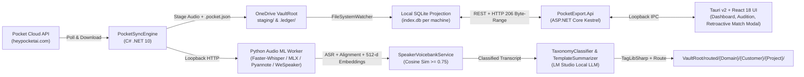

# Pocket Export Architecture

## Overview
`pocket-export` synchronizes audio recordings, cloud transcripts, and summaries from the Pocket AI API (`https://public.heypocketai.com/api/v1`) into a shared OneDrive `VaultRoot`, performs high-accuracy local re-transcription, speaker diarization, and biometric speaker identification, classifies recordings against a user-defined taxonomy (`Work/Personal`, `Customer`, `Project`, `Initiative`), routes transcripts into the taxonomy folder hierarchy, generates formatted summaries using prescribed templates via local LLMs (LM Studio), and provides a cross-platform Tauri v2 + React + C# GUI for managing recordings, playing speaker snippets, enrolling speakers, and re-tagging/re-transcribing.

## Core Subsystems & Data Flow

## Components
- **Core Domain & Orchestration (`src/PocketExport.Core`):**
  - `VaultPathResolver`: Enforces canonicalized POSIX relative paths inside `VaultRoot` with traversal protection (`GetFullPath` prefix validation) and cross-platform filename sanitization.
  - `LedgerManager` & `LedgerProjectionService`: Performs atomic `.tmp`-then-`File.Move` writes to `VaultRoot/.ledger/` with linear backoff retry for OneDrive file locks, and projects `.ledger/` manifests (`Created`, `Changed`, `Renamed`, `Deleted`) into a fast local SQLite index (`index.db` in `%LOCALAPPDATA%` / `~/Library/Application Support`) within 500ms.
  - `DistributedLeaseService`: Coordinates multi-machine active/standby polling (`primary_poller.json` with 60s TTL and 20s heartbeat renewal) and per-recording execution locks (`.ledger/locks/{id}.lock` with 15-minute crash recovery TTL).
  - `PocketSyncEngine` & `PocketApiClient`: Streams raw audio to `staging/{id}.{ext}` with content-length verification, persists verbatim `staging/{id}.pocket.json`, skips already-staged/processed recordings idempotently, and applies Polly exponential backoff on HTTP 429/5xx.
  - `AudioWorkerSupervisor` & `AudioWorkerClient`: Supervises the hermetic Python ML sidecar process (`16GB` RSS cap, health polling, crash recovery) and exchanges ASR/diarization/512-d biometric payloads.
  - `SpeakerVoicebankService`: Matches 512-d L2-normalized speaker embeddings via cosine similarity ($\ge 0.75$ auto-match, $0.70\text{--}0.74$ disambiguation, $< 0.70$ unknown), correlates Pocket cloud speaker hints, and scans historical recordings upon new speaker enrollment to populate `proposed_retroactive_matches` for explicit user approval in the GUI.
  - `TaxonomyClassifier`, `AudioContainerTagger`, `VaultFolderRouter`, & `TemplateSummarizer`: Queries LM Studio (`http://localhost:1234/v1/chat/completions`) with structured JSON schemas and `.ledger/templates/{template_id}.md` prompts, writes non-destructive audio container metadata via `TagLibSharp`, and routes Markdown transcripts/summaries to `routed/{Domain}/{Customer}/{Project}/` or `_needs_review/`.
- **ASP.NET Core Web API (`src/PocketExport.Api`):**
  - `RecordingsController` & `SpeakersController`: Exposes REST endpoints backed by `SqliteIndexContext` and `LedgerManager` for dashboard filtering, speaker enrollment, batch retroactive match approval/rejection, and manual re-tagging/re-transcription/re-summarization.
  - `AudioSnippetStreamer`: Serves RFC 9110 `HTTP 206 Partial Content` byte-range slices for 8–10s solo speaker auditioning (`[start_ms, end_ms]`).
- **Python Audio ML Worker (`src/audio-worker` via `uv`):**
  - FastAPI loopback worker (`src/server.py` `GET /health`, `POST /transcribe`) orchestrating `faster-whisper` (`large-v3-turbo` / `parakeet-tdt-0.6b-v2` on CUDA 12.8) or `mlx-whisper` (macOS Apple Silicon), `WhisperX` Wav2Vec2 word alignment (`src/aligner.py`), `pyannote/speaker-diarization-community-1` (`src/diarizer.py`), `WeSpeaker CAM++` 512-d L2-normalized embeddings (`src/biometrics.py`), and cleanest 8–10s solo snippet window selection (`src/snippet_selector.py`).
- **Tauri v2 + React/TypeScript Desktop UI (`src/ui` / `src-tauri`):**
  - `App.tsx`, `RecordingsDashboard.tsx`, `SpeakerAudition.tsx`, `SpeakerEnrollModal.tsx`, `MatchNotificationBanner.tsx`, `RetroactiveMatchesModal.tsx`, `TaxonomyEditor.tsx`, and `ReTranscribeDialog.tsx`.
